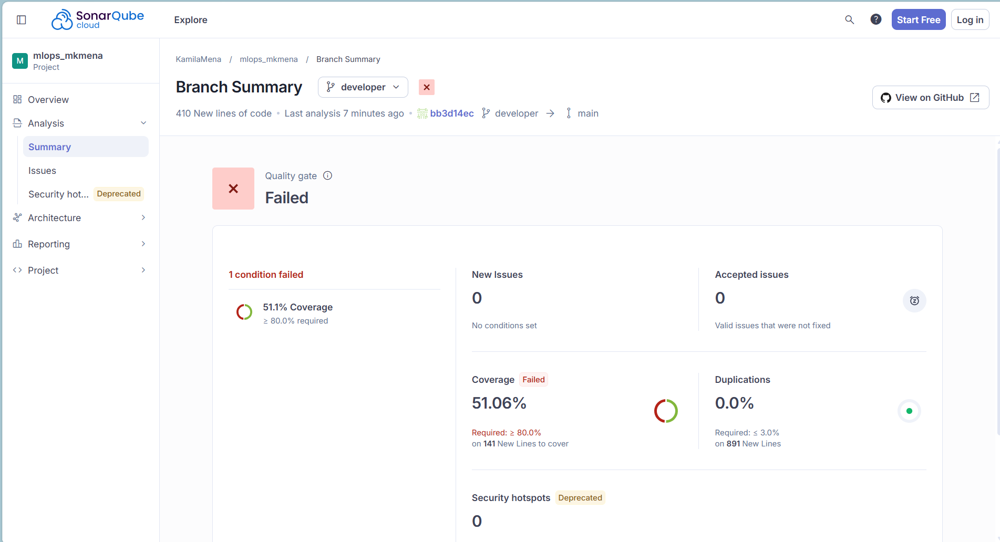

# Predicción del riesgo de incumplimiento crediticio

**Proyecto académico de Machine Learning | Machine Learning Operations (MLOps)**

Este proyecto desarrolla un flujo de Machine Learning orientado a identificar posibles incumplimientos crediticios. A partir de información de clientes, créditos e historial financiero, se exploran los datos, se entrenan y evalúan modelos de clasificación y se implementan herramientas para su monitoreo y despliegue.

El repositorio reúne las distintas etapas del proceso, desde la preparación de los datos hasta la disponibilidad del modelo mediante una API y una aplicación interactiva.

---

## 1. Contexto y objetivo del negocio

Una entidad financiera necesita identificar solicitudes de crédito con una mayor probabilidad de incumplimiento, con el propósito de contar con información que apoye sus procesos de evaluación.

El problema se aborda como una tarea de **clasificación binaria**, utilizando información relacionada con el crédito, el cliente y su historial crediticio.

La variable objetivo es `Pago_atiempo`:

| Valor | Interpretación |
|---|---|
| `1` | El cliente pagó a tiempo. |
| `0` | El cliente incumplió. |

Para el entrenamiento y el monitoreo se transforma esta etiqueta, de modo que `1` represente incumplimiento. Esta convención permite interpretar el *recall* como la proporción de incumplimientos reales que logra detectar el modelo.

> **Alcance:** prototipo académico. Los resultados no deben usarse para decisiones crediticias reales sin validación del negocio, análisis de sesgos y controles regulatorios.

## Datos y análisis exploratorio

La fuente de información utilizada es `BD_creditos.xlsx`, con **10.763 registros y 23 columnas** (créditos otorgados entre noviembre de 2024 y abril de 2026). El cargador también contempla la posibilidad de utilizar `Base_de_datos.csv`, si se encuentra disponible.

**Ninguna fila se elimina**: los valores imposibles se convierten en nulos y se imputan después, dentro del pipeline, usando solo datos de entrenamiento. En la fuente original, los casos con `Pago_atiempo = 0` representan aproximadamente el 4,75 % de los registros (511), lo que evidencia un fuerte desbalance entre las clases.

### Principales hallazgos

El análisis exploratorio permitió identificar aspectos relevantes para la preparación y el modelado:

- **Valores faltantes:** se concentran en `tendencia_ingresos` y `promedio_ingresos_datacredito` (~27 %), y faltan con más frecuencia en clientes independientes. También hay faltantes en algunas variables de saldos (1 % a 5 %).
- **Valores imposibles:** 150 edades de 121 a 123 años, 98 salarios en 0 o superiores a 100 millones, 147 puntajes de Datacrédito menores a 150 (códigos de "sin puntaje") y 58 valores numéricos dentro de `tendencia_ingresos`, que debería tener solo las categorías `Decreciente`, `Estable` y `Creciente`.
- **Límites de validación:** los rangos usados (edad entre 18 y 100 años, salario entre 1 y 100 millones, puntaje mínimo de 150) son **supuestos razonables** basados en los datos, pendientes de confirmar con el negocio.
- **Distribuciones:** los montos presentan fuerte asimetría positiva y valores extremos reales, por lo que se transforman con logaritmo en lugar de eliminarse. `saldo_mora` y `saldo_mora_codeudor` son casi todo ceros, y los pocos valores positivos corresponden a clientes en mora, la señal más informativa.
- **Señales débiles pero coherentes:** más consultas, mora, plazos largos y puntaje de Datacrédito bajo se asocian con incumplir. Ninguna variable supera 0,12 de correlación con el objetivo, por lo que se espera un desempeño modesto.
- **Variables correlacionadas:** tres pares de variables superan una correlación de 0,70 y se resuelven excluyendo una de cada par (ver sección 3.1).
- **Posible fuga de información:** la variable `puntaje` presenta una correlación de Pearson alta con el objetivo (`r = 0,926`) y por sí sola separa perfectamente las clases (AUC = 1,0). Aunque esto no demuestra causalidad, su definición y disponibilidad temporal deben revisarse. Por precaución, se excluye del conjunto utilizado para entrenar los modelos.
- **Cambio en el tiempo:** el volumen de créditos cae de forma marcada entre 2025 y 2026, lo que justifica el monitoreo de *data drift*.

Las diferencias observadas entre grupos se interpretan de manera descriptiva y no como evidencia de relaciones causales.

Los análisis y las gráficas se generan desde `mlops_pipeline/eda_analisis.py`. Los resultados gráficos se almacenan en `outputs/graficos_eda/`.

## Flujo del proyecto

| Etapa | Módulo | Descripción |
|---|---|---|
| Exploración | `mlops_pipeline/eda_analisis.py` | Caracterización y visualizaciones del dataset. |
| Ingeniería de características | `mlops_pipeline/ft_engineering.py` | Limpieza, selección y transformación de variables; genera particiones y datasets. |
| Entrenamiento | `mlops_pipeline/model_training_evaluation.py` | Compara Regresión Logística, Árbol de Decisión, Random Forest y XGBoost; evalúa y guarda el modelo seleccionado. |
| Monitoreo | `mlops_pipeline/model_monitoring.py` | Genera predicciones y reportes de data drift. |
| Dashboard | `app.py` | Presenta los resultados de monitoreo en Streamlit. |
| API | `mlops_pipeline/model_deploy.py` | Expone el modelo mediante FastAPI. |

El preprocesamiento se integra con el modelo para aplicar las mismas reglas en entrenamiento y predicción. Se realiza una partición estratificada aleatoria de 75 % para entrenamiento y 25 % para evaluación; la validación cruzada también es estratificada.

### Ejecutar el flujo

Desde PowerShell, en la raíz del repositorio:

```powershell
python -m venv .venv
.\.venv\Scripts\Activate.ps1
python -m pip install --upgrade pip
python -m pip install -r requirements.txt

python -m mlops_pipeline.eda_analisis
python -m mlops_pipeline.ft_engineering
python -m mlops_pipeline.model_training_evaluation
python -m mlops_pipeline.model_monitoring
streamlit run app.py
```

Ejecuta los módulos en ese orden. El monitoreo requiere los datasets y el modelo generados por las etapas anteriores. También se puede correr el EDA desde VS Code con **Run All Cells** en `eda_analisis.py`.

## Monitoreo y dashboard

El monitoreo separa cronológicamente los registros válidos de `fecha_prestamo`: usa aproximadamente el 75 % más antiguo como referencia y el 25 % más reciente como período actual. Calcula PSI, Jensen-Shannon, KS y chi-cuadrado, y genera predicciones para el período actual.

**Limitación importante:** aunque los períodos del análisis de drift se ordenan por fecha, los datos de origen se dividieron aleatoriamente entre entrenamiento y prueba antes de volver a unirlos. Por ello, esta comparación es retrospectiva y no constituye una validación temporal independiente. El script no calcula métricas de desempeño del modelo para el período actual, no recibe datos nuevos de producción ni ejecuta muestreos periódicos automáticamente; cada corrida es manual.

`app.py` presenta resumen, distribuciones, métricas por variable, evolución del drift y recomendaciones. La vista temporal requiere historial de ejecuciones con fechas distintas. El dashboard utiliza los reportes generados por `model_monitoring.py`, entre ellos:

- `outputs/reports/reporte_data_drift.csv`
- `outputs/reports/historial_data_drift.csv`
- `outputs/reports/datos_referencia.csv`
- `outputs/reports/datos_monitoreo.csv`

## API y Docker

La API de FastAPI carga `outputs/models/mejor_modelo.joblib` y ofrece:

| Endpoint | Uso |
|---|---|
| `GET /health` | Consultar el estado del servicio y del modelo. |
| `POST /predict` | Enviar registros JSON para obtener predicciones. |
| `POST /predict/csv` | Enviar un CSV y recibir predicciones en CSV. |

Las solicitudes deben incluir las variables predictoras requeridas, sin `Pago_atiempo`. La documentación interactiva se encuentra en `/docs`.

Construye y ejecuta la imagen desde la raíz del proyecto, después de entrenar el modelo:

```powershell
docker build -t api-riesgo-crediticio:v2 .
docker run --rm -p 8000:8000 api-riesgo-crediticio:v2
```

La API queda disponible en `http://localhost:8000` y su documentación en `http://localhost:8000/docs`. Docker instala las dependencias fijadas en `requirements-api.txt`, incluido XGBoost. Si se reentrena el modelo o se actualizan dependencias, reconstruye la imagen y verifica la compatibilidad del artefacto.

## Pruebas y SonarCloud

El repositorio contiene 16 pruebas: 14 sobre preprocesamiento e ingeniería de características y 2 sobre las funciones de salud y predicción JSON de la API. No hay pruebas automatizadas específicas para entrenamiento, monitoreo, dashboard ni para la API mediante solicitudes HTTP.

Instala las dependencias de prueba y ejecútalas desde la raíz:

```powershell
python -m pip install pytest pytest-cov
python -m pytest -v
```

GitHub Actions ejecuta las pruebas en *push* a `main` o `developer` y al abrir o actualizar un *pull request*. También genera cobertura y ejecuta el análisis de SonarCloud. La cobertura se configura para `ft_engineering` y `model_preprocessing`, no para todo el proyecto:

```powershell
python -m pytest --cov=mlops_pipeline.ft_engineering --cov=mlops_pipeline.model_preprocessing --cov-report=term-missing --cov-report=xml:coverage.xml
```

Para autenticar el análisis remoto, el repositorio de GitHub debe tener configurado el secreto `SONAR_TOKEN`.

### Captura del dashboard de SonarCloud

**Pega aquí la captura del dashboard de SonarCloud:**



## Dependencias y artefactos

- `requirements.txt`: dependencias del análisis, entrenamiento, monitoreo y dashboard.
- `requirements-api.txt`: dependencias con versiones fijadas para la API en Docker.

Los principales artefactos se guardan en `outputs/`: datasets originales y transformados en `datasets/`, modelos en `models/`, reportes del entrenamiento y monitoreo en `reports/`, y gráficos del EDA en `graficos_eda/`. Los reportes y gráficos están excluidos de Git mediante `.gitignore`; se generan localmente al ejecutar el flujo.

## Estructura principal

```text
mlops_mkmena/
├── .github/workflows/build.yml
├── mlops_pipeline/
│   ├── cargar_datos.py
│   ├── eda_analisis.py
│   ├── ft_engineering.py
│   ├── model_deploy.py
│   ├── model_monitoring.py
│   ├── model_preprocessing.py
│   └── model_training_evaluation.py
├── test/
│   ├── test_model_deploy.py
│   └── test_model_preprocessing.py
├── app.py
├── Dockerfile
├── requirements-api.txt
└── requirements.txt
```

**Proyecto final Machine Learning | 2026 - 2**
